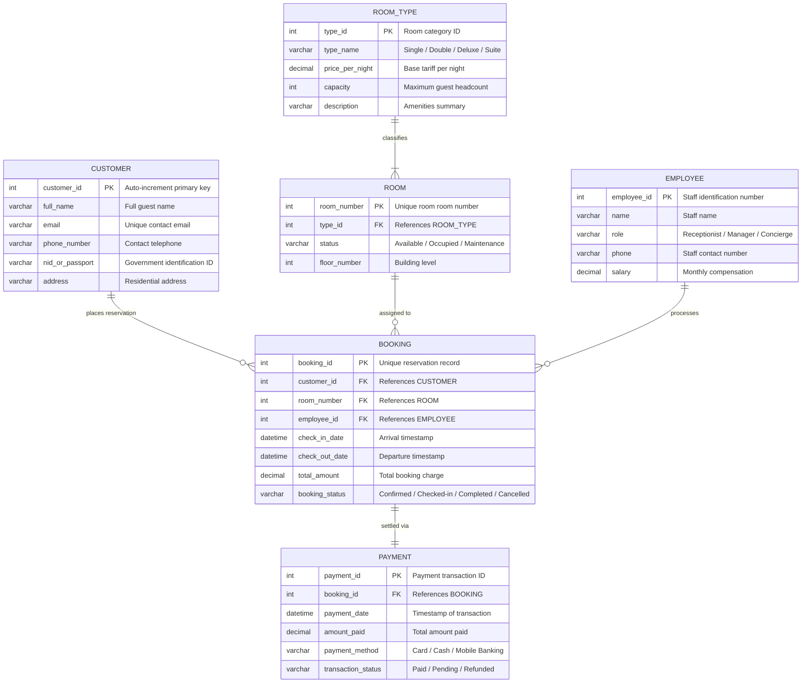
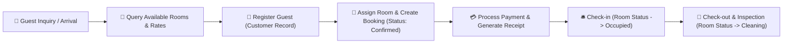

<div align="center">

# 🏨 Hotel Management System — SQL & Relational Database Architecture

[](https://www.microsoft.com/en-us/sql-server)
[](#)
[](#)
[](#)
[](#)

<p align="center">
  <b>An enterprise-grade relational database management system (RDBMS) for hotel operations.</b>
  <br />
  Built with strict 3NF normalization, foreign key referential integrity, automated booking workflows, and room availability logic.
</p>

[📌 About the Project](#-about-the-project) • [🛠️ Tech Stack](#️-comprehensive-tech-stack) • [🗄️ ER Diagram](#️-relational-entity-relationship-er-diagram) • [🚀 How to Run](#-complete-how-to-run--installation-guide) • [📊 Verification Queries](#-verification--sample-analytical-queries)

---

</div>

## 📌 About the Project

In hospitality management, data inconsistencies, double-booking errors, and untracked room statuses cost hotels revenue and guest satisfaction. 

The **Hotel Management System (HMS)** provides a production-grade relational database architecture engineered with **Microsoft SQL Server (T-SQL)**. It enforces strict referential integrity across the entire guest lifecycle—from guest reservation, identity recording, and room assignment to service billing and checkout receipts.

---

## 🛠️ Comprehensive Tech Stack

| Domain | Technology | Spec / Standard | Purpose & Implementation |
| :--- | :--- | :--- | :--- |
| **RDBMS Engine** | **Microsoft SQL Server** | `2019 / 2022 / Express` | Relational storage engine with ACID compliance |
| **Language** | **Transact-SQL (T-SQL)** | ANSI SQL Extended | DDL schema definitions, DML seed records, stored logic |
| **Design Standard**| **3NF Normalization** | Relational Theory | Eliminates insertion, update, and deletion anomalies |
| **Management GUI** | **SSMS / Azure Studio**| Official MS Tooling | Script execution, execution plan inspection, index tuning |
| **Documentation** | **IEEE SRS Format** | Word (.docx) & PDF | Full business requirement specifications and architecture diagrams |

---

## 🗄️ Relational Entity-Relationship (ER) Diagram



---

## 🔄 Guest Lifecycle Operational Workflow



---

## 📂 Repository Contents

| File Name | Purpose |
| :--- | :--- |
| `Hotel_Management_System_Table.sql` | **DDL Script**: Creates database, schemas, primary keys, foreign keys, and constraints |
| `Hotel_Management_System_Data.sql` | **DML Script**: Seed script populating room categories, sample customers, bookings, and payments |
| `Hotel_Management_System(ER).png` | High-resolution visual Entity-Relationship model |
| `Schema(Hotel_Management_System).png`| Relational table schema diagram indicating foreign key links |
| `Hotel Management System.docx / .pdf` | Complete academic/professional documentation and requirements report |

---

## 🚀 Complete How-To-Run & Installation Guide

Follow these steps to deploy and execute the database on your local machine:

### 1. Prerequisites
- **Microsoft SQL Server** (2017 or higher, Developer / Express edition)
- **SQL Server Management Studio (SSMS)** or **Azure Data Studio** / **VS Code (mssql extension)**

---

### 2. Step-by-Step Setup in SSMS

#### Step 1: Open SSMS and Connect
- Launch **SQL Server Management Studio**.
- Connect to your SQL Server instance (e.g., `localhost` or `.\SQLEXPRESS`).

#### Step 2: Create the Database & Tables (DDL)
1. In SSMS, click **New Query** (or press `Ctrl + N`).
2. Open and paste the contents of `Hotel_Management_System_Table.sql`.
3. Click **Execute** (or press `F5`).
   ```sql
   -- This will create the database and all tables with foreign-key constraints
   CREATE DATABASE HotelManagementDB;
   GO
   USE HotelManagementDB;
   GO
   ```

#### Step 3: Populate Seed Data (DML)
1. Open a new query window.
2. Open and paste the contents of `Hotel_Management_System_Data.sql`.
3. Click **Execute** (`F5`).
   *(Data will be inserted into `ROOM_TYPE`, `ROOM`, `EMPLOYEE`, `CUSTOMER`, `BOOKING`, and `PAYMENT` in proper relational order).*

---

## 📊 Verification & Sample Analytical Queries

Once loaded, run these test queries to verify the installation:

```sql
USE HotelManagementDB;
GO

-- 1. Check all available rooms by room category
SELECT 
    r.room_number,
    rt.type_name,
    rt.price_per_night,
    r.status,
    r.floor_number
FROM ROOM r
JOIN ROOM_TYPE rt ON r.type_id = rt.type_id
WHERE r.status = 'Available';

-- 2. View active bookings with customer and payment status
SELECT 
    b.booking_id,
    c.full_name AS customer_name,
    c.phone_number,
    b.room_number,
    b.check_in_date,
    b.check_out_date,
    p.amount_paid,
    p.transaction_status
FROM BOOKING b
JOIN CUSTOMER c ON b.customer_id = c.customer_id
LEFT JOIN PAYMENT p ON b.booking_id = p.booking_id;
```

---

## 👨‍💻 Author

**Momin Rifat**  
- GitHub: [@MominRifat](https://github.com/MominRifat)  
- Focus: Database Systems, SQL Architecture & Software Engineering  
- Location: Dhaka, Bangladesh
