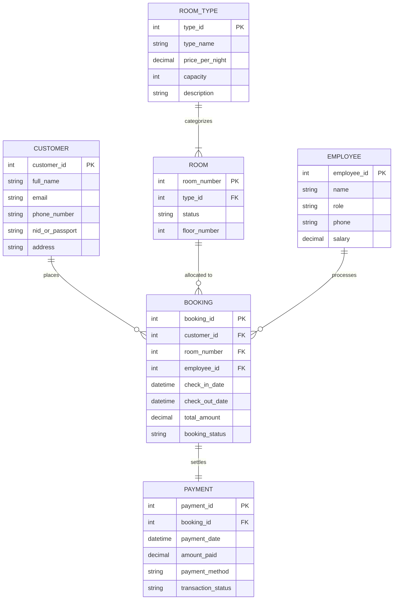
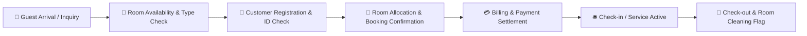

<div align="center">

# 🏨 Hotel Management System — SQL & Database Architecture

[](https://www.microsoft.com/en-us/sql-server)
[](#)
[](#)
[](#)

<p align="center">
  <b>A comprehensive, enterprise-grade relational database solution and management system for hotels.</b>
  <br />
  Designed with strict relational integrity, normalized schemas, and end-to-end workflows for reservations, guest tracking, room allocations, and billing.
</p>

---

</div>

## 📌 Executive Summary

The **Hotel Management System (HMS)** is a robust database architecture designed to eliminate operational bottlenecks in hospitality operations. It manages the complete guest lifecycle from room check-in to invoicing and checkout while enforcing ACID compliance and foreign key constraints across all relational entities.

---

## 🗄️ Relational Entity-Relationship (ER) Model



---

## 🔄 Core Operational Workflow



---

## 📁 Repository Contents

| File | Purpose |
| :--- | :--- |
| `Hotel_Management_System_Table.sql` | DDL script defining tables, primary keys, foreign keys, and default constraints |
| `Hotel_Management_System_Data.sql` | DML script providing rich seed records for rooms, customer dummy data, and bookings |
| `Hotel_Management_System(ER).png` | High-resolution visual Entity-Relationship diagram |
| `Schema(Hotel_Management_System).png` | Relational table schema blueprint showing inter-table keys |
| `Hotel Management System.docx / .pdf` | Full academic/technical project specification and requirements documentation |

---

## ⚡ Database Setup & Execution

### 1. Requirements
- **SQL Server Management Studio (SSMS)**, **Azure Data Studio**, or any standard ANSI SQL runner.

### 2. Step-by-Step Installation
Execute the scripts in strict sequence to respect foreign-key hierarchies:

1. **Create Database & Tables (DDL):**
   ```sql
   CREATE DATABASE HotelManagementDB;
   GO
   USE HotelManagementDB;
   GO
   ```
   *Run all commands in `Hotel_Management_System_Table.sql`.*

2. **Insert Initial & Seed Data (DML):**
   *Run all commands in `Hotel_Management_System_Data.sql`.*

3. **Verify Installation:**
   ```sql
   SELECT r.room_number, rt.type_name, r.status, rt.price_per_night 
   FROM ROOM r 
   JOIN ROOM_TYPE rt ON r.type_id = rt.type_id;
   ```

---

## 👨‍💻 Author

**Momin Rifat**  
- GitHub: [@MominRifat](https://github.com/MominRifat)  
- Location: Dhaka, Bangladesh
